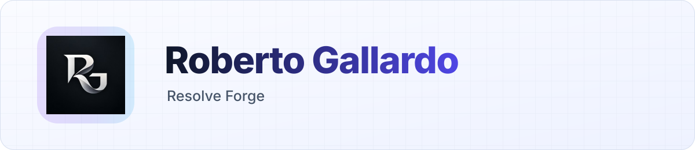

<a id="top"></a>

<div align="center">

<picture>
  <source media="(prefers-color-scheme: dark)" srcset="assets/readme/banner-es-dark.svg">
  
</picture>

<br/>

[](https://github.com/robgallardof/davinci-resolve-mcp/actions/workflows/tests.yml)


[English](README.md) · **Español**

</div>

<p align="center">
<a href="#-qué-lo-hace-distinto"><picture><source media="(prefers-color-scheme: dark)" srcset="assets/readme-builder/kit/btn-que-lo-hace-distinto-outline-sm-dark.svg" /></picture></a>
<a href="#-inicio-rápido"><picture><source media="(prefers-color-scheme: dark)" srcset="assets/readme-builder/kit/btn-inicio-rapido-outline-sm-dark.svg" /></picture></a>
<a href="#-qué-hace"><picture><source media="(prefers-color-scheme: dark)" srcset="assets/readme-builder/kit/btn-que-hace-outline-sm-dark.svg" /></picture></a>
<a href="#-herramientas-65"><picture><source media="(prefers-color-scheme: dark)" srcset="assets/readme-builder/kit/btn-herramientas-65-outline-sm-dark.svg" /></picture></a>
<a href="#-roles-y-skills"><picture><source media="(prefers-color-scheme: dark)" srcset="assets/readme-builder/kit/btn-roles-y-skills-outline-sm-dark.svg" /></picture></a>
<a href="#-pídelo-como-a-un-editor"><picture><source media="(prefers-color-scheme: dark)" srcset="assets/readme-builder/kit/btn-pidelo-como-a-un-editor-outline-sm-dark.svg" /></picture></a>
<a href="#-arquitectura"><picture><source media="(prefers-color-scheme: dark)" srcset="assets/readme-builder/kit/btn-arquitectura-outline-sm-dark.svg" /></picture></a>
<a href="#-verificación"><picture><source media="(prefers-color-scheme: dark)" srcset="assets/readme-builder/kit/btn-verificacion-outline-sm-dark.svg" /></picture></a>
</p>

<a id="-qué-lo-hace-distinto"></a>
##  Qué lo hace distinto

<!-- kit:why -->
<p align="center"><picture><source media="(prefers-color-scheme: dark)" srcset="assets/readme-builder/kit/why-es-dark.svg" /></picture></p>
<!-- /kit:why -->

<p align="center"><picture><source media="(prefers-color-scheme: dark)" srcset="assets/readme/diagrams/editing-es-dark.svg" /></picture></p>

<p align="center"></p>

<a id="-inicio-rápido"></a>
##  Inicio rápido

```powershell
powershell -NoProfile -ExecutionPolicy Bypass -File scripts/bootstrap.ps1   # Windows
```
```sh
sh scripts/bootstrap.sh                                                     # macOS / Linux
```

El bootstrap instala Python 3.12, **resolve-forge**, los extras de voz y visión, ffmpeg, el bridge para Free, las
configs de cada cliente y registra el MCP para tu usuario en cada cliente instalado.

1. **Resolve Free 21.0.x**: abre un proyecto → *Workspace → Scripts → resolve_bridge* (cada vez que abres Resolve).
   **Studio**: *Preferences → System → General → External scripting using = Local*.
2. Pide a tu agente `forge_status`.
3. Háblale como a un editor. ¿Primera vez? → [Primeros pasos](docs/FIRST-STEPS.md).

### Docker (opcional)

¿Prefieres no instalar Python? La imagen es solo el servidor MCP; Resolve y su bridge siguen en tu PC y el contenedor
llega al bridge por `host.docker.internal` (Linux: `--network host`). Los medios se montan en `/media` y
`FORGE_PATH_MAP` los traduce a la ruta que usa Resolve.

```bash
docker build -t resolve-forge:local .
export RESOLVE_FORGE_MCP_TOKEN="$(python -c 'import secrets; print(secrets.token_hex(32))')"
export FORGE_MEDIA='C:/Users/yo/Movies'
export RESOLVE_FORGE_PORT=8767
docker compose up -d --build --wait   # HTTP; Linux usa el override de docs/docker.md
```

Configuración stdio para tu cliente, variables y límites: [docs/docker.md](docs/docker.md) (en inglés).

<p align="center"></p>

<a id="-instalación-retirada-y-compatibilidad"></a>
##  Instalación, retirada y compatibilidad

Un solo instalador registra el servidor en todos los clientes que tengas, muestra el cambio antes y lo vuelve a
quitar. Respalda cada archivo que toca como `.bak` y respeta los demás servidores del archivo.

| Cliente | `--clients` | Archivo que edita | Alcance | Probado |
|---|---|---|---|---|
| Claude Code | `claude-code` | `claude mcp --scope user` (+ skills y roles en `~/.claude` con `--with-skills`) | usuario | Pruebas del instalador con archivos temporales |
| Codex | `codex` | `~/.codex/config.toml` | usuario | Pruebas del instalador con archivos temporales |
| OpenCode 1.x | `opencode` | `opencode.json` | proyecto | Prueba con el host real 1.19.4 (CI en Linux) |
| DeepSeek Harness | `deepseek` | `.dsh/mcp.cordis.yml` | proyecto | Prueba con el runtime real 0.2.1-rc.2 (CI en Linux) |
| Gemini CLI | `gemini-cli` | `~/.gemini/settings.json` | usuario | Pruebas del instalador con archivos temporales |
| Antigravity | `antigravity` | `~/.gemini/antigravity/mcp_config.json` | usuario | Pruebas del instalador con archivos temporales |
| Cursor | `cursor` | `~/.cursor/mcp.json` | usuario | Pruebas del instalador con archivos temporales |
| VS Code | `vscode` | `Code/User/mcp.json` | usuario | Pruebas del instalador con archivos temporales |
| Windsurf | `windsurf` | `~/.codeium/windsurf/mcp_config.json` | usuario | Pruebas del instalador con archivos temporales |
| Claude Desktop | `claude-desktop` | `Claude/claude_desktop_config.json` | usuario | Pruebas del instalador con archivos temporales |

```powershell
python scripts/install-mcp.py --list                        # qué clientes tienes
python scripts/install-mcp.py --dry-run                     # muestra cada cambio, no escribe nada
python scripts/install-mcp.py --with-skills                 # lo registra para tu usuario en todos, con skills y roles
python scripts/install-mcp.py --clients opencode,deepseek   # solo algunos clientes
python scripts/install-mcp.py --remove                      # deshacer (o --clients … --remove)
dsh web --patch .dsh/mcp.cordis.yml                         # DeepSeek Harness carga el overlay de forma explícita
```

Dentro de esta carpeta, `python scripts/sync.py` escribe las configs del proyecto desde una sola definición
(`config/mcp.servers.json`). La inferencia del modelo dentro de cada host necesita su propio login y no forma
parte de estas pruebas.

<!-- kit:agent-links -->
<p align="center"><a href="scripts/CLIENTS.md"><picture><source media="(prefers-color-scheme: dark)" srcset="assets/readme-builder/kit/agent-links-es-01-dark.svg" /></picture></a>&nbsp;
<a href="docs/clients.md"><picture><source media="(prefers-color-scheme: dark)" srcset="assets/readme-builder/kit/agent-links-es-02-dark.svg" /></picture></a></p>
<!-- /kit:agent-links -->

<p align="center"></p>

<a id="-qué-hace"></a>
##  Qué hace

- **Edición**: movimiento para gente hablando a cámara, versiones verticales/horizontales, mejores momentos,
  transcripción local, subtítulos animados con diseño (Creator / Studio / Editorial / Impact, karaoke), textos y entrega.
- **Ritmo para entretenimiento**: encuentra la acción (mascotas, manos, saltos), caras y tiempos muertos; rearma planos
  largos en planos de 1.2–2.8 s con encuadres abiertos, x1.25, x1.5 y crash zoom centrados en el sujeto, respetando
  pausas, acción y B-roll útil.
- **Autorrevisión**: antes de armar, qué muestra cada plano, problemas marcados, textos fuera de las caras y
  exposición/color con un CDL suave; después del render, hoja del archivo final con detección de negros y congelados.
- **Varias personas**: encuadra a quien habla (caras + boca + voz) o divide la pantalla para 2–5+ personas.
- **Composición multifuente**: mosaicos (1–5 paneles) o principal + apoyo con videos y fotos distintos, un solo audio maestro.
- **Producción por género**: comedia, música, electrónica, entrevista, cine, educación, producto, gaming y vlog;
  remates y reacciones; cortes al beat y por frase; videoclips y visualizadores; letra exacta; efectos con intención;
  música de fondo que baja bajo la voz.
- **Productor y especialistas**: `plan_production` convierte un encargo en órdenes para composición, audio, color,
  títulos y QA; proponen, y solo el productor escribe en Resolve, en serie.
- **Acabado**: presets de color y LUTs en copias; mejora de diálogo a WAV nuevos con medición LUFS/true peak.
- **Autoría**: proyectos y respaldos, bins y metadatos, ediciones versionadas, marcadores, intercambio, CDL/LUT,
  stills, Fusion, silencios/escenas/sincronía/loudness, IA nativa y QC.

La lista completa de las **65 herramientas** está en el [README en inglés](README.md#-tools-65-tools).

<p align="center"></p>

<a id="-pídelo-como-a-un-editor"></a>
##  Pídelo como a un editor

> *"Haz una versión Reels con movimiento y subtítulos bonitos con mi color de marca."*
> *"Es un stand-up: encuentra los remates y arma un TikTok sin cortar las pausas."*
> *"Del podcast horizontal haz un Reel que siga a quien habla."*
> *"Combina la entrevista con estas fotos como en esta referencia."*

Combínalo con [social-publisher-mcp](https://github.com/robgallardof/social-publisher-mcp): renderiza aquí, programa allá.

<p align="center"></p>

<a id="-roles-y-skills"></a>
##  Roles y skills

| Rol | Trabajo |
|---|---|
| `video-director` | Productor: encargo, referencias, delegación, ejecución en serie, QA final |
| `vertical-editor` / `horizontal-editor` | Editores completos para 9:16–4:5 y 16:9 |
| `composition-editor`, `audio-editor`, `colorist`, `titles-editor`, `qa-editor` | Especialistas que analizan y proponen al productor |

**Skills:** `davinci-resolve-mcp` · `editorial-direction` · `entertainment-pacing` · `vertical-video` · `horizontal-video` ·
`dynamic-zoom-talking-head` · `captions-and-titles` · `color-audio-finishing` · `video-qa` · `resolve-delivery`.
Están en inglés para servir a cualquiera; el agente te responde en español.

<p align="center"></p>

<a id="-herramientas-65"></a>
##  Herramientas (65)

| Trabajo | Herramientas |
|---|---|
| Estado y planeación | forge_status, list_clips, list_styles, list_formats, preview_motion, list_capabilities, audit_timeline, open_resolve_page |
| Edición | apply_motion, clear_motion, make_platform_version, locate_subject, find_highlights, assemble_timeline |
| Voz, texto y entrega | transcribe_timeline, align_text, list_text_styles, preview_text_style, add_captions, add_text_overlay, render_for, render_status |
| Ritmo y foco (entretenimiento) | plan_energized_edit, energize_timeline |
| Autorrevisión (antes y después del render) | review_shots, review_video |
| Varias personas (podcast, entrevista) | plan_speaker_layout, build_speaker_layout |
| Composición multifuente y órdenes del productor | plan_composition, build_composition, plan_production |
| Producción por género | plan_edit, find_story_moments, analyse_music, plan_beat_cuts, assemble_montage, create_music_visualizer |
| Sonido | add_music_bed, place_sound_effects, analyse_audio, normalise_audio, sync_audio |
| Proyectos y medios | project_workflow, configure_project, list_media, ingest_media, organise_media, media_metadata |
| Timeline | timeline_versions, edit_clips, timeline_markers, configure_track, export_interchange |
| Color y Fusion | grade_clips, inspect_grade, prepare_lut, gallery_stills, apply_fusion_graph, inspect_fusion |
| Acabado y revisiones antes del render | preflight_render, apply_grade_preset, enhance_audio |
| Recuperar la conexión | repair_bridge_connection |
| Análisis e IA nativa | analyse_scenes, native_ai |

<details>
<summary>Notas sobre algunas herramientas</summary>

- `preflight_render` revisa fuentes, pistas activas, huecos y propiedades; igual hace falta una revisión visual.
- `apply_grade_preset` muestra una vista previa por defecto y aplica CDL sobre una copia. `enhance_audio` escribe un WAV
  nuevo (filtro suave, compresión y limitador) y mide LUFS/true peak; no separa voces.
- La detección de quién habla usa movimiento de boca + energía del audio: son candidatos, no diarización. Revisa los cambios.
- `build_composition` exige `reviewed=true` después de ver la hoja y la vista previa de `plan_composition`.
- `repair_bridge_connection` (Windows) solo retira un helper del bridge huérfano cuya identidad, puerto y proceso padre
  muerto se verificaron.
</details>

<p align="center"></p>

<a id="-arquitectura"></a>
##  Arquitectura

```
mcp/resolve-forge/src/resolve_forge/
  domain/      reglas puras: encuadre, cortes, ritmo, composición, ducking, alineación, diseño de texto, formatos
  analysis/    señales (caras, movimiento, audio)       services/  casos de uso, uno por responsabilidad
  gateway · native_paths · bridge                      conexión + nuestro protocolo propio para la edición Free
  tools.py · authoring_tools.py · production_tools.py · qa_tools.py · producer_tools.py · composition_tools.py
               esquemas MCP delgados sobre un solo ejecutor en serie       server.py  raíz de composición
```

Estudiamos los MCP públicos de DaVinci Resolve y reconstruimos a nuestra manera las capacidades útiles — no se importa
ninguna implementación de la competencia. [Selección, mejoras y estado](docs/third-party-migration.md) ·
[Problemas de la API verificados](docs/api-behavior.md).

<p align="center"></p>

<a id="-verificación"></a>
##  Verificación

```sh
cd mcp/resolve-forge
uv run pytest -q          # sin Resolve
uv run pytest -m live     # con Resolve abierto y el bridge corriendo
uv run resolve-forge-doctor
python ../../scripts/test_docker.py   # imagen opcional contra un bridge real (sin Resolve)
```

<!-- kit:docs -->
<p align="center"><a href="docs/FIRST-STEPS.md"><picture><source media="(prefers-color-scheme: dark)" srcset="assets/readme-builder/kit/docs-es-01-dark.svg" /></picture></a>&nbsp;
<a href="docs/install.md"><picture><source media="(prefers-color-scheme: dark)" srcset="assets/readme-builder/kit/docs-es-02-dark.svg" /></picture></a>&nbsp;
<a href="docs/architecture.md"><picture><source media="(prefers-color-scheme: dark)" srcset="assets/readme-builder/kit/docs-es-03-dark.svg" /></picture></a>&nbsp;
<a href="docs/clients.md"><picture><source media="(prefers-color-scheme: dark)" srcset="assets/readme-builder/kit/docs-es-04-dark.svg" /></picture></a>&nbsp;
<a href="docs/editing-playbook.md"><picture><source media="(prefers-color-scheme: dark)" srcset="assets/readme-builder/kit/docs-es-05-dark.svg" /></picture></a>&nbsp;
<a href="docs/third-party-migration.md"><picture><source media="(prefers-color-scheme: dark)" srcset="assets/readme-builder/kit/docs-es-06-dark.svg" /></picture></a></p>
<!-- /kit:docs -->

<br/>

<p align="center"><a href="#top"><picture><source media="(prefers-color-scheme: dark)" srcset="assets/readme-builder/kit/btn-volver-al-inicio-outline-sm-dark.svg" /></picture></a></p>

<!-- readme-builder:signature:start -->
<p align="center"><a href="https://github.com/robgallardof"><picture><source media="(prefers-color-scheme: dark)" srcset="assets/readme/brand/signature-es-dark.svg" /></picture></a></p>
<!-- readme-builder:signature:end -->
