<a id="top"></a>

<div align="center">

<picture>
  <source media="(prefers-color-scheme: dark)" srcset="assets/readme/banner-en-dark.svg">
  
</picture>

<br/>

[](https://github.com/robgallardof/davinci-resolve-mcp/actions/workflows/tests.yml)


**English** · [Español](README.es.md)

</div>

<p align="center">
<a href="#-why-its-different"></a>
<a href="#-quick-start"></a>
<a href="#-what-it-does"></a>
<a href="#-tools-65-tools"></a>
<a href="#-roles-and-skills"></a>
<a href="#-ask-it-like-an-editor"></a>
<a href="#-architecture"></a>
<a href="#-verification"></a>
</p>

<a id="-why-its-different"></a>
##  Why it's different

| | |
|---|---|
|  **Intent, not buttons** | "Make a Reels version with movement and captions in my brand colour" → reframe, motion, captions, export. |
|  **It looks before it cuts** | Contact sheets of what each shot really shows (faces, subject, text boxes) before building, and of the rendered file after. Bad zooms are downgraded automatically. |
|  **Producer judgement by genre** | Comedy keeps the pause before the punchline; music cuts on the phrase; interviews follow whoever speaks. |
|  **Works on Resolve Free** | Our own bridge (HMAC, anti-replay, explicit method list) for the Free edition; direct scripting on Studio. |
|  **Safe by default** | Works on copies, previews with `dry_run=true`, saves before rendering, never deletes media or projects. |
|  **Any agent** | Claude Code, Codex, Antigravity, Cursor, Gemini CLI, VS Code, Windsurf, Claude Desktop — the server also ships its skills (`skill://…`) and editor roles (prompts). |

<a id="-quick-start"></a>
##  Quick start

```powershell
powershell -NoProfile -ExecutionPolicy Bypass -File scripts/bootstrap.ps1   # Windows
```
```sh
sh scripts/bootstrap.sh                                                     # macOS / Linux
```

The bootstrap installs Python 3.12, **resolve-forge**, speech/vision extras, bundled ffmpeg, the Free-edition bridge,
every client's config, and registers the MCP for your user in each installed client.

1. **Resolve Free 21.0.x**: open a project → *Workspace → Scripts → resolve_bridge* (every time Resolve starts).
   **Studio**: *Preferences → System → General → External scripting using = Local*.
2. Ask your agent for `forge_status`.
3. Talk like you would to an editor. New here? → [First steps](docs/FIRST-STEPS.md).

### Install the MCP for your user (any client)

```powershell
python scripts/install-mcp.py --list         # which clients are installed
python scripts/install-mcp.py --with-skills  # Claude Code, Codex, Antigravity, Cursor, VS Code, Gemini, Windsurf, Claude Desktop
python scripts/install-mcp.py --remove       # undo (each edited file is backed up as .bak)
```

Inside this folder, `python scripts/sync.py` writes the project configs from one launch definition
(`config/mcp.servers.json`). Paths, manual imports and troubleshooting: [client setup](docs/clients.md).

### Connect your agent

Use this server from OpenCode or DeepSeek Harness. Preview the configuration first, then apply it.

```sh
python scripts/install-mcp.py --clients opencode --dry-run
python scripts/install-mcp.py --clients opencode
opencode mcp list
```

<details>
<summary>Use DeepSeek Harness instead</summary>

```sh
python scripts/install-mcp.py --clients deepseek --dry-run
python scripts/install-mcp.py --clients deepseek
dsh web --patch .dsh/mcp.cordis.yml
```

</details>

[Configuration, removal and tested versions](scripts/CLIENTS.md).

### Docker (optional)

Prefer not to install Python? The image is only the MCP server; Resolve and its bridge keep running on your machine,
and the container reaches the bridge through `host.docker.internal` (Linux: `--network host`). Media is mounted at
`/media` and `FORGE_PATH_MAP` translates it to the host path Resolve uses.

```bash
docker build -t resolve-forge:local .
export RESOLVE_FORGE_MCP_TOKEN="$(python -c 'import secrets; print(secrets.token_hex(32))')"
export FORGE_MEDIA='C:/Users/me/Movies'
export RESOLVE_FORGE_PORT=8767
docker compose up -d --build --wait   # HTTP; see the Linux override in docs/docker.md
```

stdio client config, variables and limits: [docs/docker.md](docs/docker.md).

<a id="-what-it-does"></a>
##  What it does

- **Editorial** — motion for talking heads, vertical/horizontal platform versions, highlights, source-range assembly,
  local transcription, designed animated captions (Creator / Studio / Editorial / Impact, karaoke), text overlays, delivery.
- **Entertainment pacing** — finds the action (pets, hands, jumps), faces and dead time; rebuilds long shots as
  1.2–2.8 s shots with wide / x1.25 / x1.5 / crash-zoom framings that keep the subject centred, while protecting
  meaningful pauses, action and useful B-roll.
- **Self-review** — before building: what each shot shows, flagged problems, text positions off faces, exposure/colour
  check with a gentle CDL. After rendering: a sheet of the delivered file with black/frozen-frame detection.
- **Several people** — frame whoever is speaking (faces + mouth motion + voice) or split the screen for 2–5+ people.
- **Multi-source composition** — mosaics (1–5 panels) or hero + support from different videos and photos, one explicit
  audio master, preview first.
- **Production by genre** — briefs for comedy, music, electronic, interview, cinematic, education, product, gaming,
  vlog; punchlines and reactions; beat grid and phrase-aligned cuts; music videos and visualizers; exact lyrics timing;
  motivated sound effects; music beds ducked under the voice.
- **Producer and specialists** — `plan_production` turns a brief into work orders for composition, audio, color,
  titles and QA; they propose, only the producer writes to Resolve, serially.
- **Finishing** — color presets (natural/warm/crisp/muted) and LUTs on copies; dialogue enhancement to new WAVs with
  LUFS/true-peak measurement; pre-render checks.
- **Authoring** — projects/backups, bins and metadata, versioned clip/track edits, markers, interchange, CDL/LUT,
  gallery stills, Fusion graphs, silence/scene/sync/loudness, native AI and QC.

> Polish guidance (motivated reframes, audio bridges, camera-aware iPhone/Sony/DJI color) lives in the skills as agent
> instructions — not as extra automatic effects. There is no dedicated native transition-insertion tool yet.

<a id="-ask-it-like-an-editor"></a>
##  Ask it like an editor

> *"Make a Reels version with movement and nice captions in my brand colour."*
> *"It's stand-up: find the punchlines and build a TikTok without cutting the pauses or the laughs."*
> *"Music video for my electronic track — cuts on the beat, faster on the drop, exact lyrics."*
> *"Two people in a horizontal podcast → a Reel that follows whoever is speaking."*
> *"Interview on top, photo below, like this reference."*
> *"Background music under the podcast voice and a whoosh at each topic change."*

Pairs with [social-publisher-mcp](https://github.com/robgallardof/social-publisher-mcp): render here, schedule there.

<a id="-roles-and-skills"></a>
##  Roles and skills

| Role (`.agents/agents/`) | Job |
|---|---|
| `video-director` | Producer: brief, references, delegation, serial execution, final QA |
| `vertical-editor` / `horizontal-editor` | End-to-end editors for 9:16–4:5 and 16:9 |
| `composition-editor`, `audio-editor`, `colorist`, `titles-editor`, `qa-editor` | Specialists that analyse and propose to the producer |

**Skills** (`.agents/skills/`): `davinci-resolve-mcp` · `editorial-direction` · `entertainment-pacing` · `vertical-video` ·
`horizontal-video` · `dynamic-zoom-talking-head` · `captions-and-titles` · `color-audio-finishing` · `video-qa` · `resolve-delivery`

<a id="-tools-65-tools"></a>
##  Tools (65 tools)

| Job | Tools |
|---|---|
| State and planning | forge_status, list_clips, list_styles, list_formats, preview_motion, list_capabilities, audit_timeline, open_resolve_page |
| Editorial | apply_motion, clear_motion, make_platform_version, locate_subject, find_highlights, assemble_timeline |
| Voice, text and delivery | transcribe_timeline, align_text, list_text_styles, preview_text_style, add_captions, add_text_overlay, render_for, render_status |
| Pacing and focus (entertainment) | plan_energized_edit, energize_timeline |
| Self-review (before and after render) | review_shots, review_video |
| Several people (podcast, interview) | plan_speaker_layout, build_speaker_layout |
| Multi-source composition and producer orders | plan_composition, build_composition, plan_production |
| Production by genre | plan_edit, find_story_moments, analyse_music, plan_beat_cuts, assemble_montage, create_music_visualizer |
| Sound | add_music_bed, place_sound_effects, analyse_audio, normalise_audio, sync_audio |
| Projects and media | project_workflow, configure_project, list_media, ingest_media, organise_media, media_metadata |
| Timeline | timeline_versions, edit_clips, timeline_markers, configure_track, export_interchange |
| Color and Fusion | grade_clips, inspect_grade, prepare_lut, gallery_stills, apply_fusion_graph, inspect_fusion |
| Finishing and pre-render checks | preflight_render, apply_grade_preset, enhance_audio |
| Connection recovery | repair_bridge_connection |
| Analysis and native AI | analyse_scenes, native_ai |

<details>
<summary>Notes on a few tools</summary>

- `preflight_render` checks sources, enabled tracks, gaps and properties; a visual review is still required.
- `apply_grade_preset` previews by default and applies CDL on a copy. `enhance_audio` writes a new WAV (gentle filter,
  compression, limiter) and measures LUFS/true peak; it does not separate voices.
- Speaker detection uses mouth motion + audio energy: candidates, not diarization. Review the switches.
- `build_composition` requires `reviewed=true` after looking at the `plan_composition` sheet and preview.
- `repair_bridge_connection` (Windows) only retires an orphaned bridge helper whose identity, port and dead parent were verified.
</details>

<a id="-architecture"></a>
##  Architecture

```
mcp/resolve-forge/src/resolve_forge/
  domain/      pure rules: framing, cuts, pacing, composition, ducking, alignment, text design, formats
  analysis/    signals (faces, motion, audio)          services/  use cases, one per responsibility
  gateway · native_paths · bridge                      connection + our own Free-edition protocol
  tools.py · authoring_tools.py · production_tools.py · qa_tools.py · producer_tools.py · composition_tools.py
               thin MCP schemas over one serial executor           server.py  composition root
```

We studied the public DaVinci Resolve MCPs and rebuilt the useful capabilities our own way — no competing
implementation is imported. [Selection, improvements and status](docs/third-party-migration.md) ·
[Verified API pitfalls](docs/api-behavior.md).

<a id="-verification"></a>
##  Verification

```sh
cd mcp/resolve-forge
uv run pytest -q          # offline: Free/bridge, Studio and Resolve 19 fakes, real stdio, OS simulation
uv run pytest -m live     # Resolve open + bridge running: end-to-end render with pixel comparison
uv run resolve-forge-doctor
python ../../scripts/test_docker.py   # optional image against a real bridge listener (no Resolve needed)
```

CI runs the offline suite on Windows, macOS and Linux on every push. Commits: `git config core.hooksPath .githooks`
(strips AI co-author trailers).

<div align="center">

[First steps](docs/FIRST-STEPS.md) · [Install](docs/install.md) · [Architecture](docs/architecture.md) ·
[Clients](docs/clients.md) · [Editing playbook](docs/editing-playbook.md) · [Migration status](docs/third-party-migration.md)

</div>

<br/>

<p align="center"><a href="#top">Back to top</a></p>

<!-- readme-builder:signature:start -->
<p align="center"><a href="https://github.com/robgallardof"><picture><source media="(prefers-color-scheme: dark)" srcset="assets/readme/brand/signature-en-dark.svg" /></picture></a></p>
<!-- readme-builder:signature:end -->
