<a id="top"></a>

<div align="center">

<picture>
  <source media="(prefers-color-scheme: dark)" srcset="assets/readme/banner-en-dark.svg">
  
</picture>

<br/>

[](https://github.com/robgallardof/davinci-resolve-mcp/actions/workflows/tests.yml)


**English** · [Español](README.es.md)

</div>

<p align="center">
<a href="#-why-its-different"><picture><source media="(prefers-color-scheme: dark)" srcset="assets/readme-builder/kit/btn-why-it-s-different-outline-sm-dark.svg" /></picture></a>
<a href="#-quick-start"><picture><source media="(prefers-color-scheme: dark)" srcset="assets/readme-builder/kit/btn-quick-start-outline-sm-dark.svg" /></picture></a>
<a href="#-what-it-does"><picture><source media="(prefers-color-scheme: dark)" srcset="assets/readme-builder/kit/btn-what-it-does-outline-sm-dark.svg" /></picture></a>
<a href="#-tools-65-tools"><picture><source media="(prefers-color-scheme: dark)" srcset="assets/readme-builder/kit/btn-tools-65-tools-outline-sm-dark.svg" /></picture></a>
<a href="#-roles-and-skills"><picture><source media="(prefers-color-scheme: dark)" srcset="assets/readme-builder/kit/btn-roles-and-skills-outline-sm-dark.svg" /></picture></a>
<a href="#-ask-it-like-an-editor"><picture><source media="(prefers-color-scheme: dark)" srcset="assets/readme-builder/kit/btn-ask-it-like-an-editor-outline-sm-dark.svg" /></picture></a>
<a href="#-architecture"><picture><source media="(prefers-color-scheme: dark)" srcset="assets/readme-builder/kit/btn-architecture-outline-sm-dark.svg" /></picture></a>
<a href="#-verification"><picture><source media="(prefers-color-scheme: dark)" srcset="assets/readme-builder/kit/btn-verification-outline-sm-dark.svg" /></picture></a>
</p>

<a id="-why-its-different"></a>
##  Why it's different

<!-- kit:why -->
<p align="center"><picture><source media="(prefers-color-scheme: dark)" srcset="assets/readme-builder/kit/why-en-dark.svg" /></picture></p>
<!-- /kit:why -->

<p align="center"><picture><source media="(prefers-color-scheme: dark)" srcset="assets/readme/diagrams/editing-en-dark.svg" /></picture></p>

<p align="center"></p>

<a id="-quick-start"></a>
##  Quick start

```powershell
powershell -NoProfile -ExecutionPolicy Bypass -File scripts/bootstrap.ps1   # Windows
```
```sh
sh scripts/bootstrap.sh                                                     # macOS / Linux
```

The bootstrap installs Python 3.12, **resolve-forge**, speech/vision extras, bundled ffmpeg, the Free-edition bridge,
every client's config, and registers the MCP for your user in each installed client.

1. **Resolve Free 21.0.x**: open a project → *Workspace → Scripts → resolve_bridge* (every time Resolve starts).
   **Studio**: *Preferences → System → General → External scripting using = Local*.
2. Ask your agent for `forge_status`.
3. Talk like you would to an editor. New here? → [First steps](docs/FIRST-STEPS.md).

### Docker (optional)

Prefer not to install Python? The image is only the MCP server; Resolve and its bridge keep running on your machine,
and the container reaches the bridge through `host.docker.internal` (Linux: `--network host`). Media is mounted at
`/media` and `FORGE_PATH_MAP` translates it to the host path Resolve uses.

```bash
docker build -t resolve-forge:local .
export RESOLVE_FORGE_MCP_TOKEN="$(python -c 'import secrets; print(secrets.token_hex(32))')"
export FORGE_MEDIA='C:/Users/me/Movies'
export RESOLVE_FORGE_PORT=8767
docker compose up -d --build --wait   # HTTP; see the Linux override in docs/docker.md
```

stdio client config, variables and limits: [docs/docker.md](docs/docker.md).

<p align="center"></p>

<a id="-agent-setup-removal-and-compatibility"></a>
##  Agent setup, removal and compatibility

One installer registers the server for every client you have, shows the change first and removes it again. Each
file it edits is backed up as `.bak`, and other servers in the file are kept.

| Client | `--clients` | File it edits | Scope | Tested |
|---|---|---|---|---|
| Claude Code | `claude-code` | `claude mcp --scope user` (+ skills and roles in `~/.claude` with `--with-skills`) | user | Installer tests with temp files |
| Codex | `codex` | `~/.codex/config.toml` | user | Installer tests with temp files |
| OpenCode 1.x | `opencode` | `opencode.json` | project | Real host probe on 1.19.4 (CI on Linux) |
| DeepSeek Harness | `deepseek` | `.dsh/mcp.cordis.yml` | project | Real runtime probe on 0.2.1-rc.2 (CI on Linux) |
| Gemini CLI | `gemini-cli` | `~/.gemini/settings.json` | user | Installer tests with temp files |
| Antigravity | `antigravity` | `~/.gemini/antigravity/mcp_config.json` | user | Installer tests with temp files |
| Cursor | `cursor` | `~/.cursor/mcp.json` | user | Installer tests with temp files |
| VS Code | `vscode` | `Code/User/mcp.json` | user | Installer tests with temp files |
| Windsurf | `windsurf` | `~/.codeium/windsurf/mcp_config.json` | user | Installer tests with temp files |
| Claude Desktop | `claude-desktop` | `Claude/claude_desktop_config.json` | user | Installer tests with temp files |

```powershell
python scripts/install-mcp.py --list                        # which clients are installed
python scripts/install-mcp.py --dry-run                     # show every change, write nothing
python scripts/install-mcp.py --with-skills                 # register for your user everywhere, plus skills and roles
python scripts/install-mcp.py --clients opencode,deepseek   # only some clients
python scripts/install-mcp.py --remove                      # undo (or --clients … --remove)
dsh web --patch .dsh/mcp.cordis.yml                         # DeepSeek Harness loads the overlay explicitly
```

Inside this folder, `python scripts/sync.py` writes the project configs from one launch definition
(`config/mcp.servers.json`). Model inference inside each host needs its own login and is not part of these tests.

<!-- kit:agent-links -->
<p align="center"><a href="scripts/CLIENTS.md"><picture><source media="(prefers-color-scheme: dark)" srcset="assets/readme-builder/kit/agent-links-en-01-dark.svg" /></picture></a>&nbsp;
<a href="docs/clients.md"><picture><source media="(prefers-color-scheme: dark)" srcset="assets/readme-builder/kit/agent-links-en-02-dark.svg" /></picture></a></p>
<!-- /kit:agent-links -->

<p align="center"></p>

<a id="-what-it-does"></a>
##  What it does

- **Editorial** — motion for talking heads, vertical/horizontal platform versions, highlights, source-range assembly,
  local transcription, designed animated captions (Creator / Studio / Editorial / Impact, karaoke), text overlays, delivery.
- **Entertainment pacing** — finds the action (pets, hands, jumps), faces and dead time; rebuilds long shots as
  1.2–2.8 s shots with wide / x1.25 / x1.5 / crash-zoom framings that keep the subject centred, while protecting
  meaningful pauses, action and useful B-roll.
- **Self-review** — before building: what each shot shows, flagged problems, text positions off faces, exposure/colour
  check with a gentle CDL. After rendering: a sheet of the delivered file with black/frozen-frame detection.
- **Several people** — frame whoever is speaking (faces + mouth motion + voice) or split the screen for 2–5+ people.
- **Multi-source composition** — mosaics (1–5 panels) or hero + support from different videos and photos, one explicit
  audio master, preview first.
- **Production by genre** — briefs for comedy, music, electronic, interview, cinematic, education, product, gaming,
  vlog; punchlines and reactions; beat grid and phrase-aligned cuts; music videos and visualizers; exact lyrics timing;
  motivated sound effects; music beds ducked under the voice.
- **Producer and specialists** — `plan_production` turns a brief into work orders for composition, audio, color,
  titles and QA; they propose, only the producer writes to Resolve, serially.
- **Finishing** — color presets (natural/warm/crisp/muted) and LUTs on copies; dialogue enhancement to new WAVs with
  LUFS/true-peak measurement; pre-render checks.
- **Authoring** — projects/backups, bins and metadata, versioned clip/track edits, markers, interchange, CDL/LUT,
  gallery stills, Fusion graphs, silence/scene/sync/loudness, native AI and QC.

> Polish guidance (motivated reframes, audio bridges, camera-aware iPhone/Sony/DJI color) lives in the skills as agent
> instructions — not as extra automatic effects. There is no dedicated native transition-insertion tool yet.

<p align="center"></p>

<a id="-ask-it-like-an-editor"></a>
##  Ask it like an editor

> *"Make a Reels version with movement and nice captions in my brand colour."*
> *"It's stand-up: find the punchlines and build a TikTok without cutting the pauses or the laughs."*
> *"Music video for my electronic track — cuts on the beat, faster on the drop, exact lyrics."*
> *"Two people in a horizontal podcast → a Reel that follows whoever is speaking."*
> *"Interview on top, photo below, like this reference."*
> *"Background music under the podcast voice and a whoosh at each topic change."*

Pairs with [social-publisher-mcp](https://github.com/robgallardof/social-publisher-mcp): render here, schedule there.

<p align="center"></p>

<a id="-roles-and-skills"></a>
##  Roles and skills

| Role (`.agents/agents/`) | Job |
|---|---|
| `video-director` | Producer: brief, references, delegation, serial execution, final QA |
| `vertical-editor` / `horizontal-editor` | End-to-end editors for 9:16–4:5 and 16:9 |
| `composition-editor`, `audio-editor`, `colorist`, `titles-editor`, `qa-editor` | Specialists that analyse and propose to the producer |

**Skills** (`.agents/skills/`): `davinci-resolve-mcp` · `editorial-direction` · `entertainment-pacing` · `vertical-video` ·
`horizontal-video` · `dynamic-zoom-talking-head` · `captions-and-titles` · `color-audio-finishing` · `video-qa` · `resolve-delivery`

<p align="center"></p>

<a id="-tools-65-tools"></a>
##  Tools (65 tools)

| Job | Tools |
|---|---|
| State and planning | forge_status, list_clips, list_styles, list_formats, preview_motion, list_capabilities, audit_timeline, open_resolve_page |
| Editorial | apply_motion, clear_motion, make_platform_version, locate_subject, find_highlights, assemble_timeline |
| Voice, text and delivery | transcribe_timeline, align_text, list_text_styles, preview_text_style, add_captions, add_text_overlay, render_for, render_status |
| Pacing and focus (entertainment) | plan_energized_edit, energize_timeline |
| Self-review (before and after render) | review_shots, review_video |
| Several people (podcast, interview) | plan_speaker_layout, build_speaker_layout |
| Multi-source composition and producer orders | plan_composition, build_composition, plan_production |
| Production by genre | plan_edit, find_story_moments, analyse_music, plan_beat_cuts, assemble_montage, create_music_visualizer |
| Sound | add_music_bed, place_sound_effects, analyse_audio, normalise_audio, sync_audio |
| Projects and media | project_workflow, configure_project, list_media, ingest_media, organise_media, media_metadata |
| Timeline | timeline_versions, edit_clips, timeline_markers, configure_track, export_interchange |
| Color and Fusion | grade_clips, inspect_grade, prepare_lut, gallery_stills, apply_fusion_graph, inspect_fusion |
| Finishing and pre-render checks | preflight_render, apply_grade_preset, enhance_audio |
| Connection recovery | repair_bridge_connection |
| Analysis and native AI | analyse_scenes, native_ai |

<details>
<summary>Notes on a few tools</summary>

- `preflight_render` checks sources, enabled tracks, gaps and properties; a visual review is still required.
- `apply_grade_preset` previews by default and applies CDL on a copy. `enhance_audio` writes a new WAV (gentle filter,
  compression, limiter) and measures LUFS/true peak; it does not separate voices.
- Speaker detection uses mouth motion + audio energy: candidates, not diarization. Review the switches.
- `build_composition` requires `reviewed=true` after looking at the `plan_composition` sheet and preview.
- `repair_bridge_connection` (Windows) only retires an orphaned bridge helper whose identity, port and dead parent were verified.
</details>

<p align="center"></p>

<a id="-architecture"></a>
##  Architecture

```
mcp/resolve-forge/src/resolve_forge/
  domain/      pure rules: framing, cuts, pacing, composition, ducking, alignment, text design, formats
  analysis/    signals (faces, motion, audio)          services/  use cases, one per responsibility
  gateway · native_paths · bridge                      connection + our own Free-edition protocol
  tools.py · authoring_tools.py · production_tools.py · qa_tools.py · producer_tools.py · composition_tools.py
               thin MCP schemas over one serial executor           server.py  composition root
```

We studied the public DaVinci Resolve MCPs and rebuilt the useful capabilities our own way — no competing
implementation is imported. [Selection, improvements and status](docs/third-party-migration.md) ·
[Verified API pitfalls](docs/api-behavior.md).

<p align="center"></p>

<a id="-verification"></a>
##  Verification

```sh
cd mcp/resolve-forge
uv run pytest -q          # offline: Free/bridge, Studio and Resolve 19 fakes, real stdio, OS simulation
uv run pytest -m live     # Resolve open + bridge running: end-to-end render with pixel comparison
uv run resolve-forge-doctor
python ../../scripts/test_docker.py   # optional image against a real bridge listener (no Resolve needed)
```

CI runs the offline suite on Windows, macOS and Linux on every push. Commits: `git config core.hooksPath .githooks`
(strips AI co-author trailers).

<!-- kit:docs -->
<p align="center"><a href="docs/FIRST-STEPS.md"><picture><source media="(prefers-color-scheme: dark)" srcset="assets/readme-builder/kit/docs-en-01-dark.svg" /></picture></a>&nbsp;
<a href="docs/install.md"><picture><source media="(prefers-color-scheme: dark)" srcset="assets/readme-builder/kit/docs-en-02-dark.svg" /></picture></a>&nbsp;
<a href="docs/architecture.md"><picture><source media="(prefers-color-scheme: dark)" srcset="assets/readme-builder/kit/docs-en-03-dark.svg" /></picture></a>&nbsp;
<a href="docs/clients.md"><picture><source media="(prefers-color-scheme: dark)" srcset="assets/readme-builder/kit/docs-en-04-dark.svg" /></picture></a>&nbsp;
<a href="docs/editing-playbook.md"><picture><source media="(prefers-color-scheme: dark)" srcset="assets/readme-builder/kit/docs-en-05-dark.svg" /></picture></a>&nbsp;
<a href="docs/third-party-migration.md"><picture><source media="(prefers-color-scheme: dark)" srcset="assets/readme-builder/kit/docs-en-06-dark.svg" /></picture></a></p>
<!-- /kit:docs -->

<br/>

<p align="center"><a href="#top"><picture><source media="(prefers-color-scheme: dark)" srcset="assets/readme-builder/kit/btn-back-to-top-outline-sm-dark.svg" /></picture></a></p>

<!-- readme-builder:signature:start -->
<p align="center"><a href="https://github.com/robgallardof"><picture><source media="(prefers-color-scheme: dark)" srcset="assets/readme/brand/signature-en-dark.svg" /></picture></a></p>
<!-- readme-builder:signature:end -->
